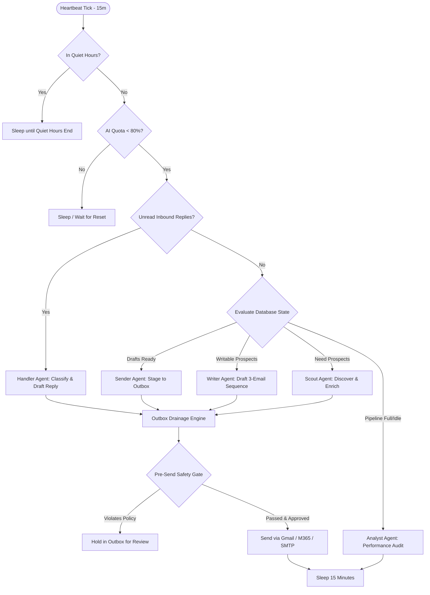

# Sellbird (formerly Harvey): Architecture, Workflow & AI Integration Blueprint

This document provides a comprehensive technical architectural review of the **Sellbird** repository, its internal mechanics, workflow pipeline, model execution paradigms, and a concrete blueprint for upgrading and integrating it with **Google Gemini** and **Antigravity**.

---

## 1. Executive Overview

**Sellbird** is an open-source, autonomous outbound sales and prospecting platform (AI SDR — *Sales Development Representative*). Unlike conventional sales automation tools (such as Apollo, ZoomInfo, Clearbit, or Clay) which charge hefty monthly subscriptions and per-token API costs, Sellbird was architected around a distinct philosophy:

1. **Subscription-Backed Inference:** It leverages existing coding assistant subscriptions (Claude Code CLI or Codex CLI) with tool-less, headless execution rather than billing users for API tokens on every turn.
2. **Deterministic-First Processing:** Web searching, site scraping, technical profiling, and pre-send safety validation are executed entirely in deterministic Python code. Large Language Models (LLMs) are invoked **only** when human judgment or creative copywriting is mandatory.
3. **Local Sovereignty & Safety:** All data, logs, credentials, and state reside locally in SQLite and OS keyrings. By default, no email leaves without explicit human approval in an Outbox review interface.

---

## 2. Tools & Technologies Stack

The following matrix categorizes all frameworks, libraries, protocols, and services powering Sellbird:

| Layer / Domain | Technology | Purpose & Implementation Details |
| :--- | :--- | :--- |
| **Language & Runtime** | **Python 3.11+** | Modern asynchronous Python (`asyncio`) leveraging native type union syntax (`X \| Y`), task shielding, and concurrent agent execution. |
| **Database & Persistence** | **SQLite** via `aiosqlite` | Embedded, zero-configuration local database (`data/sellbird.db`). Stores companies, prospects, observations, campaigns, outbox messages, and audit logs. |
| **API & Web Dashboard** | **FastAPI** & **Uvicorn** | Asynchronous REST backend (`sellbird/dashboard.py`). Serves both API endpoints and the local single-page web app at `http://127.0.0.1:5555`. |
| **Frontend UI** | **Vanilla HTML5 / CSS3 / ES6** | Zero-build UI (`sellbird/web/`). Uses native CSS variables (light/dark mode), vendored SVG assets and fonts to guarantee operation without external network dependencies. |
| **Web Scraping & DOM** | **HTTPX** & **BeautifulSoup4** | High-performance asynchronous HTTP client with exponential jittered backoff, rotating User-Agents, DOM extraction, and `schema.org` JSON-LD parsing. |
| **Browser Automation** | **Playwright** (Chromium) | Headless browser automation (`sellbird/integrations/linkedin.py`) for automated LinkedIn profile discovery and connection sequencing. |
| **Network & Mail Protocols** | **DNS**, **SMTP**, **IMAP** | `dnspython` for MX and SPF/DKIM resolution. `aiosmtplib` and standard `imaplib` for native sending and reply polling. |
| **Mail Providers** | **Gmail (OAuth2)**, **Microsoft 365 (Graph API)**, **SMTP/IMAP** | Direct first-party mailbox integrations with threading, RFC-compliant headers, and legacy Instantly API support. |
| **Email Verification** | **Reoon**, **ZeroBounce**, **Hunter.io** | Address verification services preventing domain burn. Categorizes contacts as `verified`, `risky` (catch-all), `guess`, or `invalid`. |
| **Compliance Checking** | **Precleared.dev** | Dynamic pre-send verification ensuring outreach complies with local legal frameworks across 14+ jurisdictions (US CAN-SPAM, UK PECR, Canada CASL, etc.). |
| **Warmup & Analytics** | **TrulyInbox** | Mailbox warmup telemetry integration to monitor inbox delivery rates and spam folder drift before cold outreach commences. |
| **Discovery Sources** | **OpenStreetMap (Overpass)**, **DataForSEO**, **Serper.dev**, **TinyFish** | Multi-tier business discovery from free local OpenStreetMap coordinates to paid search and startup datasets (YC, Techstars, funding rounds). |
| **Protocol Extensibility** | **Model Context Protocol (MCP)** | Built-in MCP server (`sellbird/mcp_server.py`) exposing Sellbird tools to IDE agents (Claude Code, Codex, Antigravity) over stdio. |
| **System & Desktop** | **Keyring**, **Pystray**, **Pillow** | OS-level secure secret storage, desktop system tray icon, and background process daemonization. |

---

## 3. End-to-End System Workflow

Sellbird operates as a **15-minute autonomous heartbeat loop** governed by deterministic state machines, safety gates, and specialized sub-agents.



### Detailed Pipeline Stages

#### 1. Discover Stage (`sellbird/collectors/discover.py`)
- Searches for potential businesses based on user ICP (Ideal Customer Profile) industries, roles, and geographic coordinates.
- Supports free OpenStreetMap discovery (extracts businesses, addresses, websites) or paid APIs (DataForSEO local packs, Serper Google searches, startup funding registries).
- Employs strict deduplication against existing database records.

#### 2. Profile Stage (`sellbird/collectors/profile.py`)
- **Zero-model execution:** Gathers buying signals using 3–6 fast HTTP requests per domain (e.g. homepage, `/about`, `/team`, `/contact`).
- Detects technology stack (e.g., Shopify, WordPress, Webflow, HubSpot, Google Tag Manager).
- Identifies operational signals (e.g., lacks online appointment booking, running paid ads, active hiring for target roles).
- Evaluates against the 29-signal catalog confirmed by the user.

#### 3. Enrich & Find Decision Maker (`sellbird/collectors/people.py`)
- Traverses team and about pages using French and English linguistic patterns and `schema.org` metadata.
- Finds owners, founders, CEOs, and practice managers (capped at 2 contacts per company).

#### 4. Email Resolution & Verification (`sellbird/integrations/email_finder.py`)
- Learns the company email format pattern (e.g., `first.last@domain.com` vs. `first@domain.com`).
- Dispatches a single candidate email to verification services (Reoon / ZeroBounce / Hunter).
- **Hard Gate:** If unverified or marked as a guess, outreach is halted immediately to protect domain reputation.

#### 5. Write Stage (`sellbird/agents/writer.py`)
- Invokes the LLM to write a concise 3-email sequence (Observation $\rightarrow$ Angle/Proof $\rightarrow$ Breakup).
- Injects `skills/email_frameworks.md`, `skills/product_knowledge.md`, and specific signal evidence.
- Restricts first emails to 30–50 words (maximum 75 words) with no robotic AI idioms ("I hope this finds you well").
- Wraps all external web data in `<untrusted>` tags to neutralize prompt injection attempts.

#### 6. Deterministic Pre-Send Gate & Outbox (`sellbird/gate.py` & `sellbird/agents/sender.py`)
- Every draft must pass automated deterministic checks before dispatch:
  - Subject length $\le$ 90 chars, body words $\le$ 220.
  - Zero unrendered merge tags (`{{first_name}}`).
  - No banned spam/AI phrases.
  - At most 1 hyperlinked URL (and link domain must be pre-approved).
  - Recipient not on the Do-Not-Contact list.
  - Compliance check passed via Precleared.dev.
- By default, emails wait in the **Outbox** for manual human approval (`copilot` mode). When configured to `autopilot`, approved emails drain with human-like jitter delays (4–15 seconds) within recipient office hours.

#### 7. Reply Handling & Lifecycle (`sellbird/agents/handler.py`)
- Reads inbound replies across connected inboxes.
- Runs regex-based and multi-lingual opt-out recognition (English, French, Spanish, Hebrew) to guarantee instant unsubscription.
- Uses the LLM to categorize valid replies (`accepted_offer`, `interested`, `objection`, `question`, `ooo`, `wrong_person`).
- Prepares responses or triggers handoff webhooks/MCP tools when an offer is accepted.

---

## 4. Current Model Architecture & Limitations

Sellbird currently supports two LLM execution engines configured via `brain.provider` in `sellbird.yaml`:

```
sellbird/
  ├── brain.py            # Unified Brain facade, usage metrics, prompt/skill loader
  ├── claude_runtime.py   # Claude Code CLI headless runner
  └── codex.py            # OpenAI Codex CLI runtime adapter
```

### Current Providers Matrix

| Feature / Property | Claude Engine (`claude`) | Codex Engine (`codex`) |
| :--- | :--- | :--- |
| **Invocation Channel** | Headless CLI Subprocess (`claude -p`) | Stdio IPC with `codex app-server` |
| **Authentication** | Operator's Claude Pro/Max subscription | Operator's ChatGPT subscription via Codex login |
| **Tool Surface** | Hard-disabled (`--tools ""` & `--safe-mode`) | Hard-disabled (Direct tool mode with zero tools) |
| **Working Directory** | Isolated, empty temporary directory | Isolated, private `CODEX_HOME` |
| **Prompt Delivery** | Streamed via standard input (`stdin`) | Structured protocol message over stdio |
| **Model Selection** | Default Claude model or configured alias | `gpt-5.5`, `gpt-4o`, `gpt-6.1-sol`, etc. |
| **Platform Compatibility**| macOS, Linux, Windows | **macOS and Linux only** (Windows refused) |
| **Version Rigidity** | Any version supporting isolation flags | **Locked strictly to `@openai/codex@0.159.3`** |

### Key Limitations in the Existing Setup

1. **Tight CLI Coupling:** Both providers depend on third-party command-line binaries (`claude` or `codex`) being installed in the OS path, rather than standard client libraries or HTTP APIs.
2. **Version Pinning Vulnerability:** The Codex adapter strictly validates version `0.159.3`. Any minor update to the npm package causes Sellbird to refuse execution.
3. **Absence of Native Gemini Integration:** In `sellbird/config.py`, the configuration validator explicitly restricts `BRAIN_PROVIDERS` to `("claude", "codex")`. Attempting to set `gemini` currently raises a `ConfigError`.
4. **Subscription-Rate Bottlenecks:** Claude and ChatGPT subscription limits (e.g. 5-hour rolling windows) can pause the pipeline for hours when usage exceeds 80%.

---

## 5. Blueprint: Gemini & Antigravity Integration

Sellbird is well-positioned for integration with **Google Gemini** and the **Antigravity** agent platform. Several clean architectural seams already exist in the codebase.

```mermaid
graph TD
    subgraph Sellbird Core
        Heartbeat[Heartbeat Loop] --> StateMgr[State Manager]
        Heartbeat --> Brain[sellbird.brain.Brain]
        Brain --> PromptsSkills[prompts/ & skills/ Loader]
    end

    subgraph Integration Seams
        Brain -. Route 1 .-> TransportHook[Brain Transport Hook: async transport()]
        Brain -. Route 2 .-> GeminiProvider[Native Gemini Provider: sellbird/gemini_runtime.py]
        Brain -. Route 3 .-> AntigravityProvider[Antigravity CLI / Agent: sellbird/agy_runtime.py]
    end

    subgraph Upstream LLM Engines
        TransportHook --> CloudAPI[Google GenAI SDK / Vertex AI / REST]
        GeminiProvider --> GeminiFlash[Gemini 2.5 Flash / Gemini 1.5 Pro]
        AntigravityProvider --> AGYWorkflow[Antigravity Workspace & Swarm]
    end

    subgraph Inbound Control
        AGYAssistant[Antigravity Agent / Chat] --> MCPClient[MCP Protocol Client]
        MCPClient --> SellbirdMCP[sellbird/mcp_server.py]
        SellbirdMCP --> DashboardAPI[Dashboard Loopback API]
    end
```

### Approach 1: Native Gemini Provider (`brain.provider: gemini`)

This is the most direct, robust, and performant method for running Sellbird on Google Gemini models (e.g., `gemini-2.5-flash`, `gemini-1.5-pro`).

#### Implementation Steps:
1. **Add Dependency:** Add `google-genai` (or `google-generativeai`) to `pyproject.toml` and `requirements.txt`.
2. **Implement `sellbird/gemini_runtime.py`:**
   Create an asynchronous adapter that reads `GEMINI_API_KEY` from the environment or `.env` and issues generation requests.
   ```python
   # Outline for sellbird/gemini_runtime.py
   import os
   from google import genai
   from google.genai import types

   class GeminiRuntime:
       def __init__(self, model_name: str = "gemini-2.5-flash"):
           self.client = genai.Client(api_key=os.environ.get("GEMINI_API_KEY"))
           self.model = model_name

       async def generate(self, prompt: str, expect_json: bool = False) -> str:
           config = types.GenerateContentConfig(
               response_mime_type="application/json" if expect_json else "text/plain",
               temperature=0.3,
           )
           response = await self.client.aio.models.generate_content(
               model=self.model,
               contents=prompt,
               config=config
           )
           return response.text
   ```
3. **Register `gemini` in `sellbird/config.py`:**
   Update `BRAIN_PROVIDERS`:
   ```python
   BRAIN_PROVIDERS = ("claude", "codex", "gemini")
   ```
4. **Hook into `Brain.think()` in `sellbird/brain.py`:**
   Add branch:
   ```python
   if self.provider == "gemini":
       return await self._think_gemini(prompt, expect_json=expect_json, ...)
   ```

#### Benefits of Native Gemini:
- **Massive Context & Low Latency:** Gemini 2.5 Flash offers near-instantaneous inference for prospect scoring and email drafting.
- **Native JSON Enforcement:** Through `response_mime_type="application/json"`, parsing errors in `think_json()` are virtually eliminated.
- **Cost Efficiency:** Running hundreds of cold email generations costs mere fractions of a cent per day.

---

### Approach 2: Zero-Code Ingestion via `Brain(transport=...)` Seam

The codebase already provides an architected extension hook: the `transport` parameter on `Brain.__init__`. 

In [sellbird/brain.py](file:///home/nallasivan/Desktop/projects/claude-skills/sellbird/sellbird/brain.py#L100-L115):
```python
class Brain:
    def __init__(self, state: StateManager, brain_config=None, transport=None):
        """transport, when given, replaces the Claude and Codex CLIs: an
        async transport(prompt, *, agent, task, timeout, expect_json) -> str
        that returns the model's text ("" on failure)."""
```
When running Sellbird as a module or embedded worker, you can inject a Gemini or Antigravity transport function directly without modifying the core `sellbird` package files.

---

### Approach 3: Two-Way Antigravity Integration

Antigravity and Sellbird can interface in two distinct, complementary ways:

#### A. Antigravity Superintending Sellbird (Via MCP)
Sellbird already contains a full Model Context Protocol server in [sellbird/mcp_server.py](file:///home/nallasivan/Desktop/projects/claude-skills/sellbird/sellbird/mcp_server.py).
- Antigravity can connect to Sellbird using MCP (`sellbird mcp`).
- The user can prompt Antigravity:
  > *"Check Sellbird's Today screen, summarize pending outbox emails, and propose a new offer."*
- Antigravity invokes tools:
  - `today()` $\rightarrow$ retrieves pipeline summary and pending approvals.
  - `stats()` $\rightarrow$ pipeline conversions and active campaigns.
  - `offer_suggest()` / `offer_preview()` $\rightarrow$ crafts high-conversion entry offers.
  - `pause_sending()` $\rightarrow$ immediate circuit-breaker.

#### B. Antigravity CLI Execution Runtime (`brain.provider: antigravity`)
Sellbird can delegate its thinking tasks directly to the Antigravity engine (`agy` CLI):
- Create `sellbird/antigravity_runtime.py` calling `agy` non-interactively in standard sandbox mode.
- Enables Sellbird to leverage whichever model the user has selected within Antigravity (e.g. Gemini 3.8 Flash, Pro, etc.).

---

## 6. Actionable Upgrade & Modernization Plan

To modernize this repository and complete the Gemini/Antigravity integration, follow these structured steps:

```
[Phase 1: Environment & Health Validation]
   ├── 1.1 Verify virtual environment and python 3.11+
   ├── 1.2 Run existing test suite to establish clean baseline
   └── 1.3 Initialize default configuration files (sellbird.yaml, .env)

[Phase 2: Gemini Brain Provider Implementation]
   ├── 2.1 Add google-genai dependency to pyproject.toml
   ├── 2.2 Implement sellbird/gemini_runtime.py with async client
   ├── 2.3 Update sellbird/config.py: Add 'gemini' to BRAIN_PROVIDERS and model regex
   ├── 2.4 Update sellbird/brain.py: Integrate _think_gemini() and usage accounting
   └── 2.5 Author unit tests: tests/test_gemini_brain.py

[Phase 3: Antigravity MCP Plugin Configuration]
   ├── 3.1 Register Sellbird MCP server in Antigravity's settings
   ├── 3.2 Add an Antigravity custom skill or prompt template for outreach oversight
   └── 3.3 Test bidirectional communication (today, outbox inspection, stats)

[Phase 4: Safety & Verification Run]
   ├── 4.1 Perform dry-run prospecting: `sellbird discover --estimate`
   ├── 4.2 Verify email generation with Gemini Flash
   └── 4.3 Validate deterministic pre-send gate blocking invalid drafts
```

---

## 7. Key File References & Architecture Map

- **Pipeline Engine & Decision Loop:** [main.py](file:///home/nallasivan/Desktop/projects/claude-skills/sellbird/sellbird/main.py#L154-L205)
- **Thinking Engine & Transport Seam:** [brain.py](file:///home/nallasivan/Desktop/projects/claude-skills/sellbird/sellbird/brain.py#L99-L150)
- **Configuration & Provider Schema:** [config.py](file:///home/nallasivan/Desktop/projects/claude-skills/sellbird/sellbird/config.py#L699-L745)
- **Scouting & Signal Enrichment:** [scout.py](file:///home/nallasivan/Desktop/projects/claude-skills/sellbird/sellbird/agents/scout.py#L1-L60)
- **Email Generation & Sequence Crafting:** [writer.py](file:///home/nallasivan/Desktop/projects/claude-skills/sellbird/sellbird/agents/writer.py#L1-L50)
- **Deterministic Pre-Send Safety Gate:** [gate.py](file:///home/nallasivan/Desktop/projects/claude-skills/sellbird/sellbird/gate.py#L1-L45)
- **Native Mailbox Dispatch & Pacing:** [sender.py](file:///home/nallasivan/Desktop/projects/claude-skills/sellbird/sellbird/agents/sender.py#L1-L45)
- **Reply Classifier & Opt-Out Handling:** [handler.py](file:///home/nallasivan/Desktop/projects/claude-skills/sellbird/sellbird/agents/handler.py#L40-L100)
- **MCP Server for Coding Agents:** [mcp_server.py](file:///home/nallasivan/Desktop/projects/claude-skills/sellbird/sellbird/mcp_server.py#L1-L60)
- **Sales Methodology & Frameworks:** [email_frameworks.md](file:///home/nallasivan/Desktop/projects/claude-skills/sellbird/skills/email_frameworks.md)
